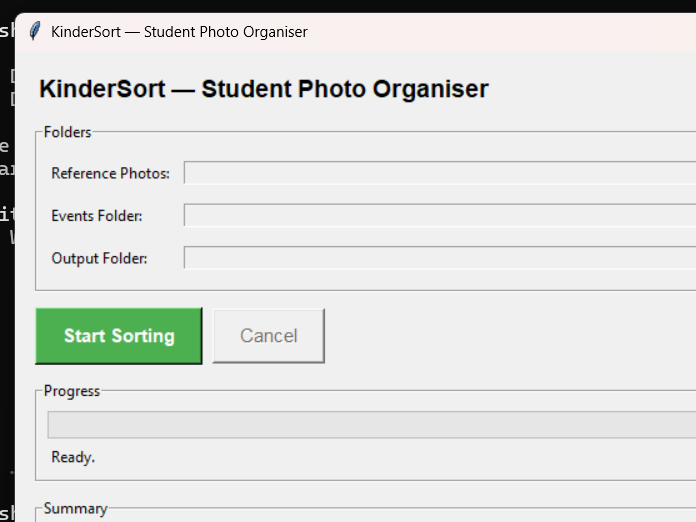
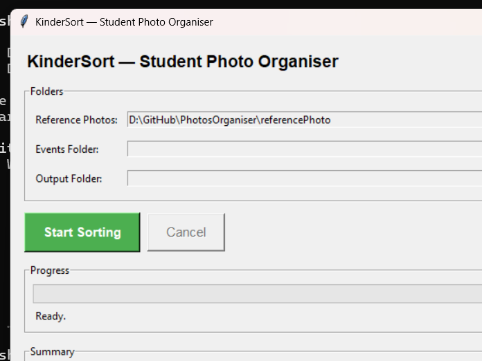
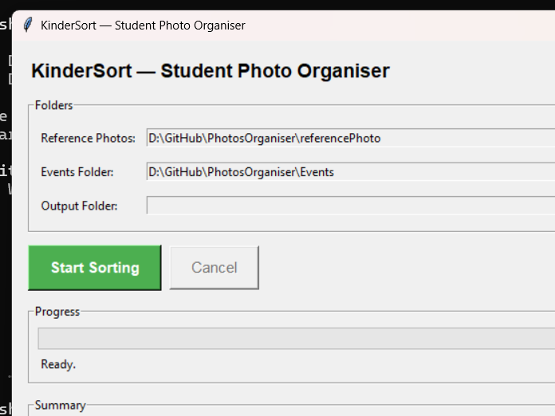
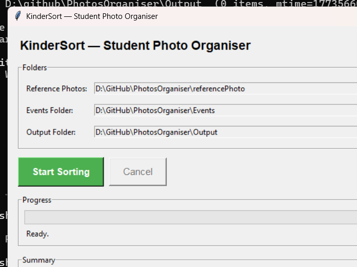
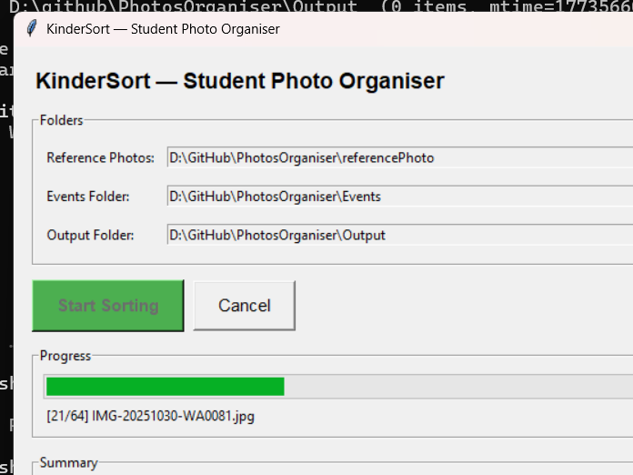
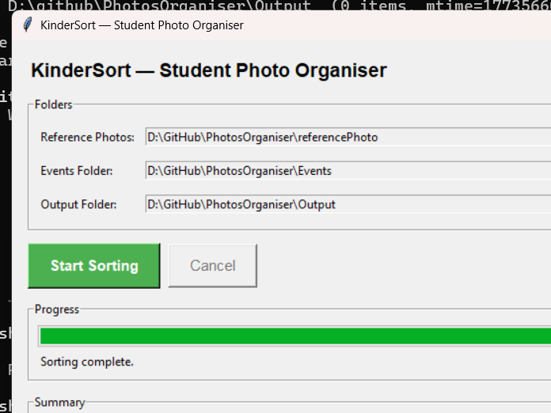
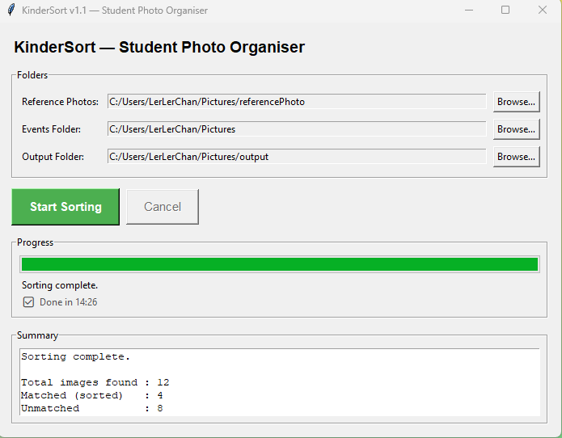

# KinderSort — Student Photo Organiser

[](https://github.com/lerlerchan/KinderSort/releases)
[](https://www.python.org/)
[](https://github.com/lerlerchan/KinderSort)
[](https://github.com/lerlerchan/KinderSort)
[](https://github.com/lerlerchan/KinderSort/releases)
[](https://github.com/lerlerchan/KinderSort/releases)

[中文说明 (简体)](README.zh-CN.md)

KinderSort is an offline desktop app for kindergarten teachers. It scans event photos, matches student faces, and copies each photo into the correct student folder automatically — no internet connection, no coding knowledge required.

---

## Highlights

| Feature | Detail |
|---|---|
| Fully offline | No cloud upload, no internet required |
| CPU-only | No GPU required; compatible dependencies and sufficient resources are still needed |
| Simple GUI | Point-and-click, no terminal needed |
| Group photo support | One photo copied to all matched students |
| Safe operation | Files are **copied**, never moved or deleted |
| Audit trail | Detailed log written to `kindersort_log.txt` |

---

## Who this is for

- Teachers who need to organise large batches of student photos quickly
- Schools that require local/offline processing for privacy

---

## Quick Start (Teachers)

1. Download `KinderSort.exe` from the [**Releases**](https://github.com/lerlerchan/KinderSort/releases) page
2. Double-click `KinderSort.exe` — no installation needed
3. Select the three folders (Reference / Events / Output)
4. Click **Start Sorting**
5. Review the summary and open the Output folder

Full illustrated teacher guide: [`guidebook.md`](guidebook.md)

---

## Screenshot Walkthrough

| Step | Screenshot |
|---|---|
| 1. App launch |  |
| 2. Reference folder selected |  |
| 3. Events folder selected |  |
| 4. All folders ready |  |
| 5. Sorting in progress |  |
| 6. Sorting complete |  |
| 7. Timer display during sorting |  |

---

## Folder Setup

You choose three folders inside the app:

1. **Reference Photos** — one clear front-facing photo per student, file name = student name
   ```
   reference/
     Ali.jpg
     Siti.png
     Kumar.jpeg
   ```

2. **Events Folder** — subfolders of mixed event photos
   ```
   events/
     Sports_Day/
     Concert/
     Field_Trip/
   ```

3. **Output Folder** — where sorted results are written

---

## Output Structure

```text
Output/
  Ali/
    Sports_Day__IMG_001.jpg
    Concert__IMG_045.jpg
  Siti/
    Sports_Day__IMG_001.jpg    ← same photo, Siti was also in it
    Field_Trip__IMG_023.jpg
  _unmatched/
    blurry_photo.jpg
    no_face_detected.jpg
  kindersort_log.txt
```

---

## Important Behaviour

- The GUI distinguishes normal unmatched photos from processing errors. “Sorting completed with errors” includes error details in the Summary box and `kindersort_log.txt`. Photos without preserved error copies are a subset of processing errors, not additional errors.
- Fatal failures stop sorting and report an incomplete task. Originals and completed copies remain; partial counts are unavailable, and group photos may have copies in only some student folders. Check disk space, permissions and drive availability before retrying. Retries preserve existing photos and may create numbered duplicates.
- If the log file cannot be opened, sorting does not start. Correct output permissions or file locks and retry. Cancellation leaves completed copies in place and reports an incomplete task.
- Face matching threshold is `0.55` (strict — minimises false positives)
- Photos are **copied**, not moved — originals are always safe
- Photos placed directly in the Events root (no subfolders) are also supported — the folder name is used as the event name
- If any supported reference photo cannot be read or produce a usable face encoding, sorting is blocked. Replace or correct the listed photos before trying again.
- v1.1 uses CNN + multi-jitter recognition. Runtime depends on hardware and image content; the spinning timer indicates that the GUI is responding, not that recognition has finished.

---

## Tech Stack

[](https://github.com/ageitgey/face_recognition)
[](https://python-pillow.org/)
[](https://docs.python.org/3/library/tkinter.html)
[](https://pyinstaller.org/)

| Component | Library |
|---|---|
| Face recognition | `face_recognition` + `dlib` |
| Image handling | `Pillow` |
| GUI | `tkinter` (built-in) |
| Packaging | `PyInstaller` |
| Language | Python 3.10+ |

---

## Developer Setup

Validated source environment: Windows, Python **3.11.9**, dlib **19.24.2**, face_recognition **1.3.0**, face_recognition_models **0.3.0**, NumPy **1.26.4**. Python 3.10+ is the source syntax minimum; other environments have not been validated here. `requirements.txt` pins the four direct runtime dependencies, including Pillow 10.3.0; `face_recognition_models` is transitive. tkinter must be available in the Python installation.

The commands below are source setup instructions, not a guaranteed one-click Windows installation. Installing dlib may require a compatible compiler/toolchain or a separately verified wheel; this audit did not install dependencies, compile dlib or validate a fresh machine. PyInstaller and python-docx are optional packaging/document tools, not runtime requirements. Building an executable and distributing third-party models require separate validation; no installer or release binary was produced in this audit.

Use PowerShell activation with `.\.venv\Scripts\Activate.ps1` (subject to your existing local policy; do not weaken security policy for this project), or invoke `.\.venv\Scripts\python.exe` directly.

```bash
python -m venv .venv
.venv\Scripts\activate
pip install -r requirements.txt
python main.py
```

Build Windows executable:

```bash
pyinstaller --onefile --windowed --name "KinderSort" main.py
# Output: dist/KinderSort.exe
```

## Safe use and current guide

See [the current teacher guide](guidebook.md#safety-retry-and-privacy) for filename rules, folder safety, Cancel/close behavior, error counts, retries and privacy. Existing Word documentation and screenshots are historical and have not been revalidated for this source version. Release links above do not establish that a downloadable executable contains these changes.

Output must be separate from both inputs. Use ordinary local folders without links/reparse points and do not change them while sorting. Reference names must be unique ignoring case and extension; `_unmatched` and `kindersort_log.txt` are reserved, and names must not end in a period or space. Activity root photos and nested subfolders are supported.

`_unmatched` contains normal nonmatches and readable originals of processing-error photos; check Summary to distinguish them. The log is `Output/kindersort_log.txt` and may contain names, paths and reference error text. Protect photos and logs under school privacy rules and manually verify matches before sharing.

Cancel waits for reference loading/collection and the current activity operation, then stops before the next photo. Closing waits for the worker to finish safely. Completed copies remain; retries preserve existing photos and can add numbered duplicates. Total counts discovered photos, including unprocessed photos after cancellation; matched counts photos rather than group copies.

Regression check (use the validated environment):

```powershell
python -B -m unittest discover -s tests -p "test_*.py" -v
python -B -m pip check
```
