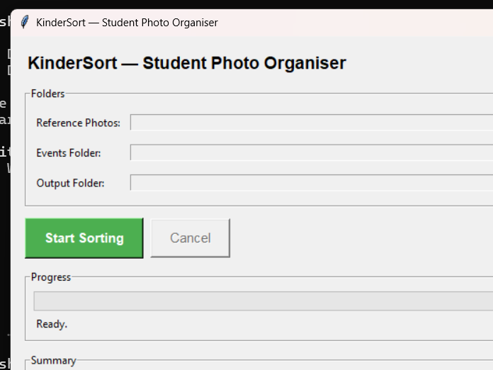
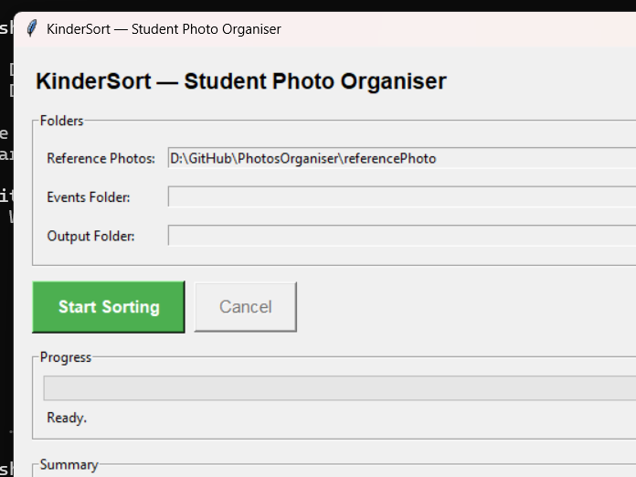
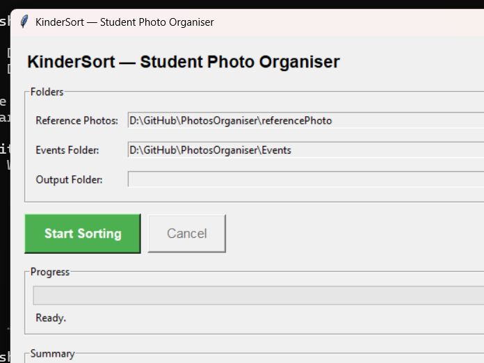
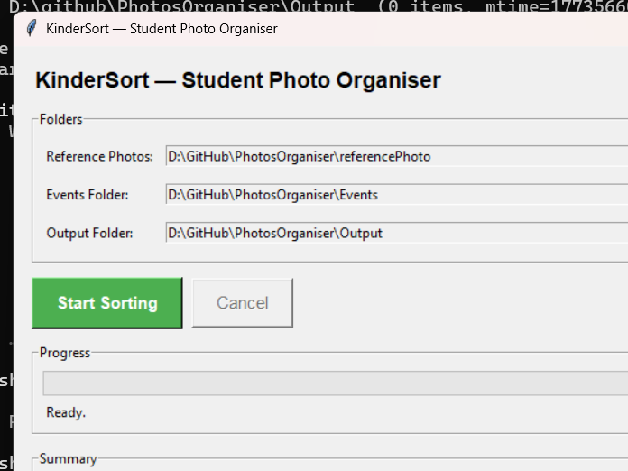
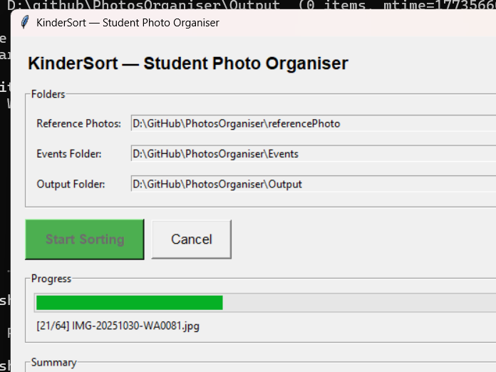
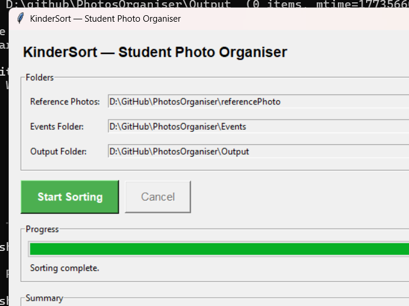
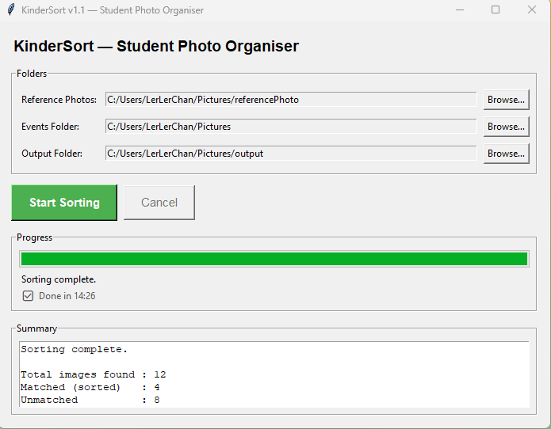

# KinderSort — 幼儿园学生照片整理工具

[](https://github.com/lerlerchan/KinderSort/releases)
[](https://www.python.org/)
[](https://github.com/lerlerchan/KinderSort)
[](https://github.com/lerlerchan/KinderSort)
[](https://github.com/lerlerchan/KinderSort/releases)
[](https://github.com/lerlerchan/KinderSort/releases)

[English](README.md)

KinderSort 是一个离线桌面工具，面向幼儿园老师。它会扫描活动照片，识别学生人脸，并自动把照片复制到对应学生文件夹——无需网络连接，无需任何编程知识。

---

## 功能亮点

| 功能 | 说明 |
|---|---|
| 全离线运行 | 不需要上传云端，不需要联网 |
| 仅使用 CPU | 普通 Windows 电脑无需显卡即可运行 |
| 简易图形界面 | 点击操作，无需使用命令行 |
| 支持合照 | 同一张照片可复制到多个学生文件夹 |
| 安全操作 | 照片只会**复制**，不会移动或删除原图 |
| 操作日志 | 自动生成 `kindersort_log.txt` 详细记录 |

---

## 适用场景

- 老师需要快速整理大量学生活动照片
- 学校对隐私有要求，必须本地离线处理

---

## 使用步骤（老师快速上手）

1. 从 [**Releases**](https://github.com/lerlerchan/KinderSort/releases) 页面下载 `KinderSort.exe`
2. 双击运行 `KinderSort.exe`——无需安装
3. 依次选择三个目录（Reference / Events / Output）
4. 点击 **Start Sorting**
5. 查看完成摘要并打开输出目录确认结果

完整图文使用手册：[`guidebook.md`](guidebook.md)

---

## 界面截图步骤

| 步骤 | 截图 |
|---|---|
| 1. 程序启动界面 |  |
| 2. 已选择参考照片目录 |  |
| 3. 已选择活动照片目录 |  |
| 4. 三个目录都已设置完成 |  |
| 5. 正在整理照片 |  |
| 6. 整理完成摘要 |  |
| 7. 整理中——计时器显示 |  |

---

## 目录设置要求

在程序中需要选择 3 个文件夹：

1. **Reference Photos（参考照片）** — 每位学生一张清晰正脸照，文件名即学生姓名
   ```
   reference/
     Ali.jpg
     Siti.png
     Kumar.jpeg
   ```

2. **Events Folder（活动照片目录）** — 包含多个活动子文件夹
   ```
   events/
     Sports_Day/
     Concert/
     Field_Trip/
   ```

3. **Output Folder（输出目录）** — 整理结果写入位置

---

## 输出结构示例

```text
Output/
  Ali/
    Sports_Day__IMG_001.jpg
    Concert__IMG_045.jpg
  Siti/
    Sports_Day__IMG_001.jpg    ← 同一张照片，Siti 也在里面
    Field_Trip__IMG_023.jpg
  _unmatched/
    blurry_photo.jpg
    no_face_detected.jpg
  kindersort_log.txt
```

---

## 关键行为说明

- 人脸匹配阈值为 `0.55`（偏严格，减少误匹配）
- 照片只会**复制**，不会移动原图，原始文件始终安全
- 支持将照片直接放在 Events 根目录（不含子文件夹），程序会以该文件夹名作为活动名称
- 任一支持格式的参考照无法读取或生成人脸编码时，整批排序将被阻止。请更换或修正提示中的参考照后重试。
- v1.1 采用 CNN + 多次抖动识别；耗时取决于硬件和照片内容。旋转计时器表示界面仍在响应，不代表识别已经完成。

---

## 技术栈

[](https://github.com/ageitgey/face_recognition)
[](https://python-pillow.org/)
[](https://docs.python.org/3/library/tkinter.html)
[](https://pyinstaller.org/)

| 组件 | 库 |
|---|---|
| 人脸识别 | `face_recognition` + `dlib` |
| 图像处理 | `Pillow` |
| 图形界面 | `tkinter`（内置） |
| 打包工具 | `PyInstaller` |
| 开发语言 | Python 3.10+ |

---

## 开发者本地运行（源码）

本次验证环境为 Windows、Python **3.11.9**、dlib **19.24.2**、face_recognition **1.3.0**、face_recognition_models **0.3.0**、NumPy **1.26.4**。Python 3.10+ 为源码语法最低要求，其他环境未在本次验收。requirements.txt 固定四项直接运行依赖（包括 Pillow 10.3.0）；模型包为间接依赖。Python 需提供 tkinter。

以下不是保证成功的一键安装流程：Windows 安装 dlib 可能需要兼容编译工具链或单独验证的 wheel。此次未安装依赖、编译 dlib 或验证全新机器。PyInstaller 和 python-docx 分别属于可选打包、文档工具，不属于运行依赖；此次未制作安装程序或发布二进制文件。

PowerShell 激活命令为 `.\.venv\Scripts\Activate.ps1`；若现有策略不允许，可直接调用 `.\.venv\Scripts\python.exe`，不要降低系统安全设置。

```bash
python -m venv .venv
.venv\Scripts\activate
pip install -r requirements.txt
python main.py
```

打包 Windows 可执行文件：

```bash
pyinstaller --onefile --windowed --name "KinderSort" main.py
# 输出：dist/KinderSort.exe
```

## 安全使用与当前版本说明

- 以 [Markdown 使用手册](guidebook.md#safety-retry-and-privacy) 为当前说明。既有 Word 手册、截图是历史资料，未按此次修复重新生成或验收；Releases 链接不能证明下载的 EXE 已包含这些修改。
- Output 不得与任一输入相同、互相包含。使用普通本地目录，不使用 symlink、junction 或其他重解析点；运行期间不要替换文件或目录。
- 参考照直接放在 Reference 下，每人一张，文件名去除扩展名后为姓名；忽略大小写不得重名。不得使用 `_unmatched`、`kindersort_log.txt`，姓名不得以空格或句点结尾，且须符合 Windows 文件命名规则。
- Events 支持根目录照片与多层子目录。根目录照片使用根目录名称作前缀；嵌套照片使用 Events 下第一级子目录名称作前缀。
- `_unmatched` 既包含正常未匹配照片，也可能包含处理失败照片可读取的原始字节副本，须根据 Summary 区分。日志位于 `Output/kindersort_log.txt`。
- Cancel 在参考照加载、活动收集和当前活动照片操作结束后，于下一张照片前停止，不能立即中断识别或复制。关闭窗口会请求取消并等待工作线程安全结束，请勿强制终止。
- 取消或失败后保留已完成副本；合照可能只复制到部分学生目录。重试前检查已有输出或选择新的空目录；原输出不覆盖，可能新增 `_2`、`_3` 等重复副本。
- Total 为发现的照片数，取消后包含未处理照片；Matched 按照片计数而非合照副本数。Processing errors 不计入正常 unmatched；未保留错误照片数是错误数的子集。可放大窗口或滚动查看 Summary。
- 仅在学校授权下处理真实学生照片。输入、输出和日志应存于受控本地存储，避免公共目录或自动同步分享。日志可能包含姓名、路径、匹配距离和参考照库异常原文；不要附到 PR 或问题报告。运行中日志写入失败可能无 GUI 告警，日志不保证完整。分享前人工核对识别结果和接收者，遵循学校保留期限。

回归检查（在已验证环境中执行）：

```powershell
python -B -m unittest discover -s tests -p "test_*.py" -v
python -B -m pip check
```
