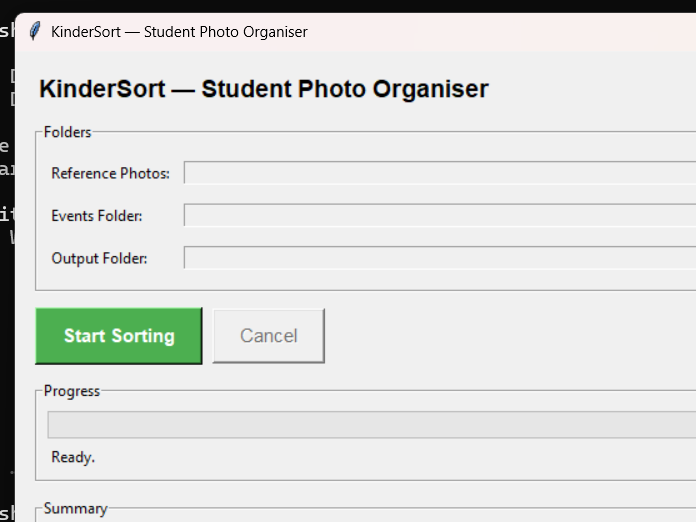
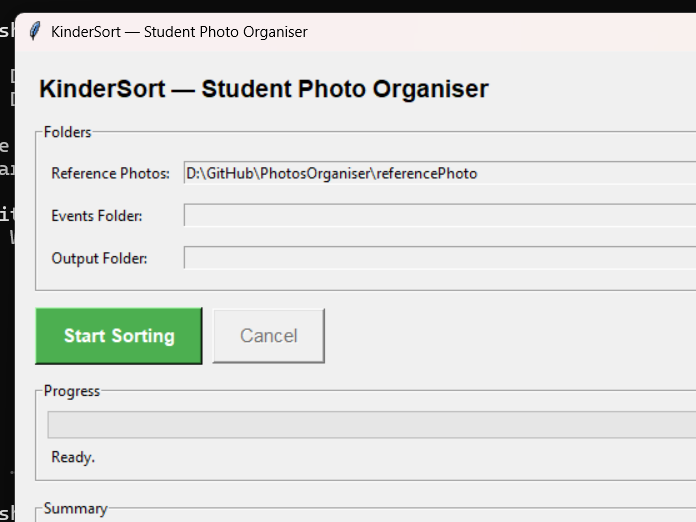
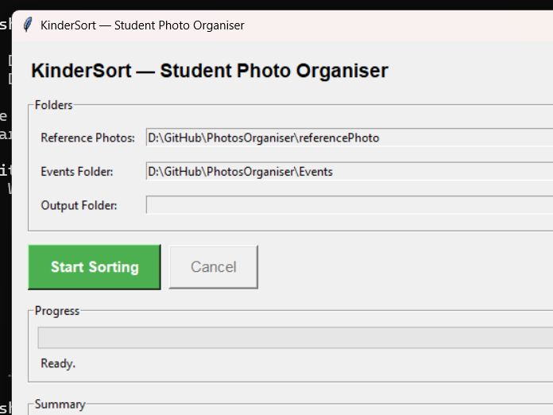
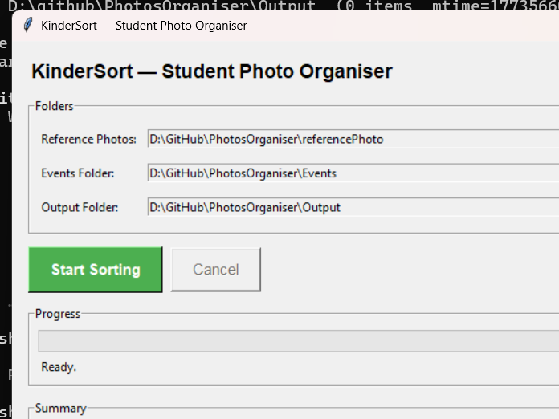
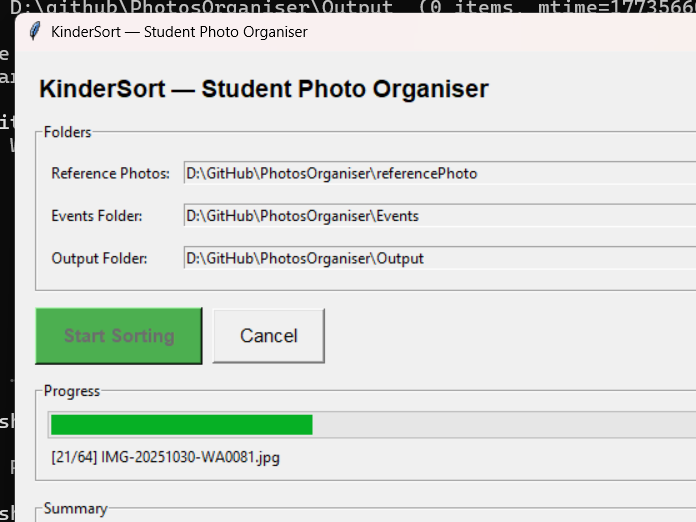
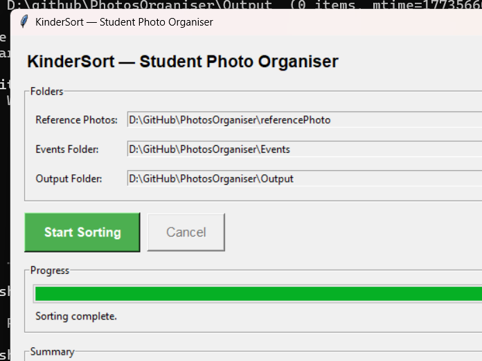

# KinderSort — Teacher's Guide

*How to sort your students' event photos automatically*

---

## What KinderSort Does

KinderSort looks at each photo from a school event and finds your students' faces.
It then automatically puts each photo into the right student's folder — so you don't
have to sort hundreds of photos by hand!

**One photo can appear in multiple folders** — for example, a group shot with three
students will be copied to all three students' folders.

---

## Before You Start

You need three folders ready on your computer:

### 1. Reference Photos Folder
One clear, front-facing photo of each student.
- Name each photo with the student's full name
- Examples: `Ali.jpg`, `Siti.png`, `Kumar.jpeg`
- Make sure the face is clearly visible and well-lit

### 2. Events Folder
A folder containing photos directly at its root, in event subfolders, or in nested folders within those event subfolders. Subfolders are optional; use one per event to keep event names clear.
- Example structure:
  ```
  Events/
      Sports_Day/
          IMG_001.jpg
          IMG_002.jpg
      Field_Trip/
          IMG_003.jpg
  ```
- Photos can also be directly in Events; its folder name becomes their event prefix. Nested photos use the first subfolder under Events as their event name.

### 3. Output Folder
A separate folder where KinderSort will save the sorted results. It must not be the same as, inside, or contain either input folder.
Starting with an empty output folder is recommended, but is not required. Existing photos are preserved; retries can produce numbered duplicate copies such as `_2` and `_3`.

---

## Step-by-Step Guide

### Step 1 — Open KinderSort

Double-click the **KinderSort.exe** file to launch the app.



You will see three folder selector rows at the top.

---

### Step 2 — Select Your Reference Photos Folder

Click the **Browse…** button next to "Reference Photos".

Navigate to your folder of student reference photos and click **Select Folder**.



The path to your folder will appear in the box.

---

### Step 3 — Select Your Events Folder

Click the **Browse…** button next to "Events Folder".

Navigate to your Events folder (containing root-level photos, event subfolders, or both) and click **Select Folder**.



---

### Step 4 — Select Your Output Folder

Click the **Browse…** button next to "Output Folder".

Navigate to your separate output folder (preferably empty for a new run) and click **Select Folder**.

When all three folders are selected, the app is ready.



---

### Step 5 — Start Sorting

Click the large green **Start Sorting** button.

KinderSort will begin processing your photos. You will see:
- A **progress bar** filling up as photos are processed
- A **status line** showing the current photo filename



> Processing time depends on hardware, image content and the number of photos; no fixed processing time is guaranteed.

**Cancel** requests a safe stop before the next activity photo. Reference loading and activity collection must finish first; the current recognition/copy operation is not interrupted. Completed copies remain and the task is incomplete. Closing the window requests cancellation and waits for the worker to finish safely; do not force-terminate it.

---

### Step 6 — Review the Results

When sorting is complete, you will see a summary:



The summary shows:
- **Total images found** — how many photos were scanned
- **Matched (sorted)** — how many photos were placed into student folders
- **Unmatched** — photos where no student face was recognised
- **Processing errors** — photos that failed reading, detection, encoding, matching or source copying; excluded from matched and normal unmatched counts
- **Error photos without preserved copies** — a subset of processing errors whose source bytes could not be copied

Total is the number of discovered activity photos, including unprocessed photos after cancellation. A group photo counts once as matched, regardless of the number of student copies. Expand the window or scroll the Summary text to see all details.

---

## Understanding Your Output Folder

After sorting, your Output folder will look like this:

```
Output/
    Ali/
        Sports_Day__IMG_001.jpg
        Concert__IMG_045.jpg
    Siti/
        Sports_Day__IMG_001.jpg   ← same group photo, copied here too
        Field_Trip__IMG_023.jpg
    _unmatched/
        Sports_Day__blurry_photo.jpg
        Sports_Day__background_only.jpg
    kindersort_log.txt
```

**Each student has their own folder** containing all photos where their face was detected.

The **`_unmatched` folder** contains:
- Photos where no faces were detected (e.g. landscape shots, blurry images)
- Photos where faces were detected but didn't match any student (e.g. teachers, parents)
- Original bytes of processing-error photos, when readable; these are errors, not normal unmatched results. Check Summary before using them.

The **`kindersort_log.txt` file** is a detailed record of everything KinderSort did.
You don't need to read it normally, but it's useful if something seems wrong.

---

## Common Problems & Solutions

### Reference photo validation error on startup
**Cause:** One or more supported reference photos could not be read or produce a usable face encoding. The error lists the affected filenames and reasons. Sorting has not started.

**Fix:** Correct or replace every listed photo, then start sorting again. Check that each file opens and is readable. For face-related errors, use a clear, front-facing photo with good lighting and a plain background.

### Many photos end up in `_unmatched`
**Possible causes:**
1. Reference photo quality is poor — use a clearer photo
2. Event photos are very blurry or taken from far away
3. Students are wearing face masks or hats in the event photos

**Fix:** Try better reference photos first. KinderSort cannot recognise faces that
are partially covered or turned away.

### "Missing folders" error when clicking Start
**Fix:** Make sure all three folder fields are filled in before clicking Start Sorting.

### The app seems stuck / progress bar not moving
**Possible cause:** Face recognition is CPU-intensive; a stationary progress bar alone does not prove a failure or successful processing.

**Fix:** Allow time for the current operation. Runtime varies by computer and photo content.
Watch the status line — if it shows a new filename, it is still running.

### Output folder photos have long names like `Sports_Day__IMG_001.jpg`
This is normal! The event folder name is added as a prefix so you always know
which event a photo came from.

---

## Tips for Better Results

1. **Use a clear, recent reference photo** — front-facing, good lighting, no sunglasses
2. **One face per reference photo** — if a reference photo has multiple faces, KinderSort uses the first face detected
3. **Consistent lighting** helps — very dark or backlit event photos may not match well
4. **Review matches manually** before sharing: face recognition can make mistakes; the current threshold is `0.55`.
5. **Keep events in subfolders** for clear output prefixes; photos directly in Events are also supported.

## Safety, Retry and Privacy

- Use ordinary local folders without symlinks, junctions or other reparse points. Output must neither contain nor be inside either input folder. Do not replace files or folders while sorting.
- Reference photos must be directly in Reference, one per student, with unique names ignoring case and extension. Do not use `_unmatched` or `kindersort_log.txt` as the name before the image extension, or names ending in a period or space. Use names valid on Windows and one face per photo.
- Supported formats: `.jpg`, `.jpeg`, `.png`, `.bmp`, `.webp`. Other extensions are ignored.
- Output errors stop the batch. Completed copies remain; a group photo may have copies in only some student folders. After correcting the problem, inspect existing output or choose a new empty output folder. Retrying preserves existing photos and may add `_2`, `_3` copies.
- The log is `Output/kindersort_log.txt`. It can contain student names, local paths, match distances and reference-library error text. Runtime log write failures may leave the log incomplete without a GUI warning; do not rely on it as a complete audit trail.
- Process real student photos only with school authorization. Keep inputs, outputs and logs in access-controlled local storage, outside public or automatically shared folders. Do not attach them to issues or PRs. Check recipients and matches before sharing; follow school retention rules.
- This Markdown guide is the current source. The existing Word guide and screenshots predate these fixes and may show older behavior; they have not been regenerated or revalidated for release.

---

*KinderSort — Student Photo Organiser | Runs fully offline, no internet required*
